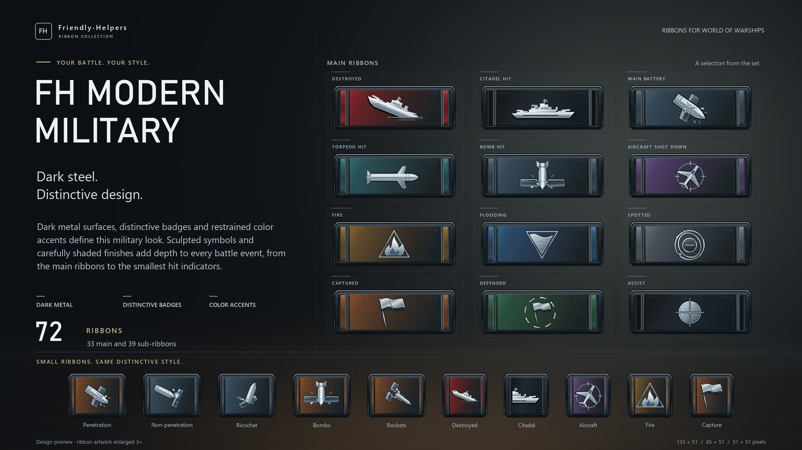

# FH Modern Military

**Friendly-Helpers · Ribbon Collection**

Designvorschau für World of Warships · Design showcase for World of Warships

## Deutsch

Dunkle Metallflächen, markante Abzeichen und gezielte Farbakzente prägen diesen militärischen Stil. Plastische Symbole und fein abgestufte Oberflächen verleihen den Gefechtsereignissen Tiefe – vom großen Ribbon bis zur kleinen Trefferanzeige.

Das Set umfasst **72 Grafiken**: 33 Haupt-Ribbons, 25 rechteckige und 14 quadratische Untergrafiken.

Die Vorschau zeigt zwölf Haupt-Ribbons und zehn Untergrafiken, jeweils 3× vergrößert.

## English

Dark metal surfaces, distinctive badges and restrained color accents define this military look. Sculpted symbols and carefully shaded finishes add depth to every battle event, from the main ribbons to the smallest hit indicators.

The set contains **72 graphics**: 33 main ribbons, 25 rectangular sub-ribbons and 14 square sub-ribbons.

The preview shows twelve main ribbons and ten sub-ribbons, each enlarged 3×.

