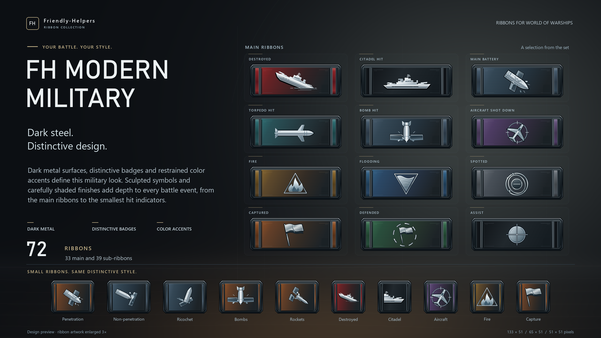

# FH Modern Military

**Friendly-Helpers · Ribbon Collection**

Designvorschau für World of Warships · Design showcase for World of Warships

**FH-Version / FH version: 1.0.0 · Stand / Updated: 05.11.2026**

## Deutsch

Dunkle Metallflächen, markante Abzeichen und gezielte Farbakzente prägen diesen militärischen Stil. Plastische Symbole und fein abgestufte Oberflächen verleihen den Gefechtsereignissen Tiefe – vom großen Ribbon bis zur kleinen Trefferanzeige.

Das Set umfasst **72 Grafiken**: 33 Haupt-Ribbons, 25 rechteckige und 14 quadratische Untergrafiken.

Die Vorschau zeigt zwölf Haupt-Ribbons und zehn Untergrafiken, jeweils 3× vergrößert.

### Offizieller World of Warships ModHub

**Von Wargaming freigegeben und im offiziellen ModHub veröffentlicht:** [FH Modern Military im ModHub](https://mods.worldofwarships.com/mod/409). Alle vier FH-Ribbon-Sets sind über die [offizielle WoWS ModStation](https://worldofwarships.eu/en/content/modstation/) verfügbar. Der GitHub-Release-Download bleibt als alternative manuelle Installation verfügbar.

### Download und Installation

**FH-Version: 1.0.0.** [FH_Modern_Military.zip direkt herunterladen](https://github.com/FeuchterHase/fh-modern-military/releases/download/v1.0.0/FH_Modern_Military.zip) · [Release v1.0.0](https://github.com/FeuchterHase/fh-modern-military/releases/tag/v1.0.0).

Das ZIP enthält 72 PNGs und `INSTALL_DE.txt` / `INSTALL_EN.txt`. Das benannte Release-ZIP verwenden; GitHubs automatische „Source code“-Archive enthalten die Showcase-Dateien.

1. World of Warships vollständig schließen.
2. Den aktiven Modordner öffnen: `WoWS/bin/AKTIVE_BUILDNUMMER/res_mods/`. In `game_info.xml` unter `version name="client", installed` ist die letzte Zahl die Buildnummer. Die Datei nur lesen.
3. Vorhandene eigene Ribbon-Moddateien sichern. Nur einen FH-Stil gleichzeitig verwenden.
4. Das ZIP entpacken und nur seinen Ordner `gui` nach `res_mods` kopieren. Ergebnis: `res_mods/gui/ribbons/` und `res_mods/gui/ribbons/subribbons/`.
5. Spiel starten und Darstellung im Übungsgefecht prüfen.

Spieloriginale in `res`, `idx`, `res_packages` sowie Loader-/XML-Dateien behalten.

**Deinstallation:** Spiel schließen. Nur die aus diesem Paket installierten 72 PNG-Dateien anhand der ZIP-Dateinamen entfernen oder die eigene Sicherung zurückspielen. Andere Mods und Spieloriginale behalten.

### Prüfung und Konflikte

**WoWS 15.10.0.0 (Build 13533378) ist technisch geprüft.** Alle 72 Pfade, PNG-Maße und Transparenzeigenschaften passen. Von den Spieloriginalen sind 67 byteidentisch und fünf Motive für den neuen Gefechtsmodus optisch verändert. Pfade und Maße dieser fünf bleiben gleich. Das Set verwendet weiterhin die bestehenden FH-Motive. Das ZIP v1.0.0 eignet sich für die manuelle Installation. Der Spieltest unter 15.10 steht noch aus. FeuchterHase hat alle 72 Gefechtsereignisse unter 15.9 einzeln im Spiel getestet. Der ModHub-Eintrag ist derzeit für 15.9 gekennzeichnet.

Alle vier FH-Stile belegen dieselben 72 PNG-Pfade und schließen sich gegenseitig aus. Andere Ribbon-Mods mit denselben Pfaden können ebenfalls überschrieben werden. Nur eine Ribbon-Ersetzung für diese Ressourcen auswählen.

Die anderen drei Stile: [FH Clear](https://github.com/FeuchterHase/fh-clear) · [FH Premium Gaming](https://github.com/FeuchterHase/fh-premium-gaming) · [FH Naval Heritage](https://github.com/FeuchterHase/fh-naval-heritage).

### Projekt und Kontakt

**Projekt / Autor: Friendly Helpers.** GitHub: [FeuchterHase](https://github.com/FeuchterHase). Discord: [feuchterhase.](https://discord.com/users/554090481093574667).

## English

Dark metal surfaces, distinctive badges and restrained color accents define this military look. Sculpted symbols and carefully shaded finishes add depth to every battle event, from the main ribbons to the smallest hit indicators.

The set contains **72 graphics**: 33 main ribbons, 25 rectangular sub-ribbons and 14 square sub-ribbons.

The preview shows twelve main ribbons and ten sub-ribbons, each enlarged 3×.

### Official World of Warships ModHub

**Approved by Wargaming and published in the official ModHub:** [FH Modern Military on ModHub](https://mods.worldofwarships.com/mod/409). All four FH ribbon sets are available through the [official WoWS ModStation](https://worldofwarships.eu/en/content/modstation/). The GitHub release remains available as an alternative manual download.

### Download and installation

**FH version: 1.0.0.** [Download FH_Modern_Military.zip](https://github.com/FeuchterHase/fh-modern-military/releases/download/v1.0.0/FH_Modern_Military.zip) · [Release v1.0.0](https://github.com/FeuchterHase/fh-modern-military/releases/tag/v1.0.0).

The ZIP contains 72 PNGs and `INSTALL_DE.txt` / `INSTALL_EN.txt`. Use the named release ZIP; GitHub's automatic “Source code” archives contain the showcase files.

1. Fully close World of Warships.
2. Open the active mod folder: `WoWS/bin/ACTIVE_BUILD/res_mods/`. In `game_info.xml`, the final number under `version name="client", installed` is the build number. Read this file without editing it.
3. Back up existing ribbon-mod files. Use only one FH style at a time.
4. Extract the ZIP and copy only its `gui` folder into `res_mods`. The result is `res_mods/gui/ribbons/` with `res_mods/gui/ribbons/subribbons/` inside it.
5. Start the game and check the appearance in a training battle.

Keep original files in `res`, `idx` and `res_packages`, and loader/XML files, unchanged.

**Uninstall:** Close the game. Remove only this package's 72 installed PNGs, matching their names against the ZIP, or restore your backup. Keep other mods and original game files.

### Verification and conflicts

**WoWS 15.10.0.0 (build 13533378) has passed the resource compatibility check.** All 72 paths, PNG dimensions and transparency properties match. Of the original game assets, 67 are byte-identical and five designs for the new battle mode have changed visually. Those five retain their paths and dimensions. The set keeps the existing FH artwork. The v1.0.0 ZIP can be used for manual installation. In-game testing on 15.10 is pending. FeuchterHase tested all 72 battle events individually in game on 15.9. The ModHub entry currently lists 15.9.

All four FH styles use the same 72 PNG paths and are mutually exclusive. Other ribbon mods writing these paths may also be overwritten. Select only one ribbon replacement for these resources.

The other three styles: [FH Clear](https://github.com/FeuchterHase/fh-clear) · [FH Premium Gaming](https://github.com/FeuchterHase/fh-premium-gaming) · [FH Naval Heritage](https://github.com/FeuchterHase/fh-naval-heritage).

### Project and contact

**Project / author: Friendly Helpers.** GitHub: [FeuchterHase](https://github.com/FeuchterHase). Discord: [feuchterhase.](https://discord.com/users/554090481093574667).
